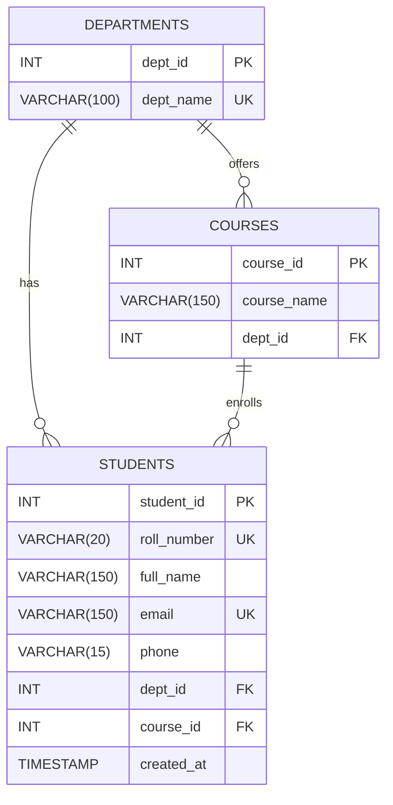

# ER Diagram — Student Management System

## Entity-Relationship Diagram (Mermaid format)



---

## Relational Schema

```
departments (
    dept_id   INT AUTO_INCREMENT PRIMARY KEY,
    dept_name VARCHAR(100) NOT NULL UNIQUE
)

courses (
    course_id   INT AUTO_INCREMENT PRIMARY KEY,
    course_name VARCHAR(150) NOT NULL,
    dept_id     INT NOT NULL,
    FOREIGN KEY (dept_id) REFERENCES departments(dept_id),
    UNIQUE (course_name, dept_id)
)

students (
    student_id  INT AUTO_INCREMENT PRIMARY KEY,
    roll_number VARCHAR(20)  NOT NULL UNIQUE,
    full_name   VARCHAR(150) NOT NULL,
    email       VARCHAR(150) NOT NULL UNIQUE,
    phone       VARCHAR(15),
    dept_id     INT NOT NULL,
    course_id   INT NOT NULL,
    created_at  TIMESTAMP DEFAULT CURRENT_TIMESTAMP,
    FOREIGN KEY (dept_id)   REFERENCES departments(dept_id),
    FOREIGN KEY (course_id) REFERENCES courses(course_id)
)
```

---

## Relationships Explained

| Relationship          | Type        | Description                                  |
|-----------------------|-------------|----------------------------------------------|
| DEPARTMENTS → COURSES | One-to-Many | One department can offer multiple courses     |
| DEPARTMENTS → STUDENTS| One-to-Many | One department can have multiple students     |
| COURSES → STUDENTS    | One-to-Many | One course can enroll multiple students       |

### Cardinality
- A **department** must have at least 0 courses (can exist without any course).
- A **course** must belong to exactly 1 department.
- A **student** must belong to exactly 1 department and exactly 1 course.
